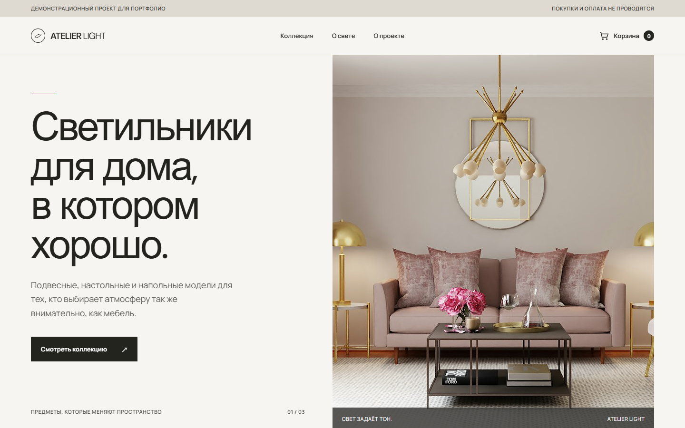
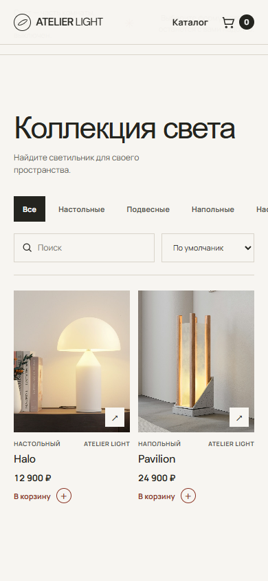

# ATELIER LIGHT — интернет-магазин освещения

**Тип:** демонстрационный проект для портфолио  
**Задача:** показать умение собрать не только красивую главную страницу, но и рабочий путь выбора товара.

## Задача и решение

Для предметов интерьера важен контекст: покупатель хочет увидеть, как светильник меняет комнату. Поэтому главная страница сочетает крупные фотографии помещений, спокойную типографику и каталог с простыми инструментами выбора.

В каталоге можно выбрать тип светильника, найти модель по названию или описанию и отсортировать товары по цене. Из карточки можно открыть подробности или сразу добавить товар в корзину. Корзина позволяет менять количество, сохраняется в браузере и ведет к демонстрационной форме заказа.

## Моя работа

- Структура страницы и визуальная система.
- Адаптивная верстка для настольных и мобильных экранов.
- Каталог, поиск, фильтры, сортировка, карточки товаров, корзина и демозаказ на JavaScript.
- Состояния пустого поиска и пустой корзины, поддержка клавиатуры и уменьшенного движения.

## Технологии

HTML, CSS, JavaScript без фреймворка и сборки. Фотографии сохранены в проекте, поэтому для их загрузки не требуется сторонний фотосервис.

## Ограничения демо

ATELIER LIGHT — концептуальный бренд. Товары, цены и описания созданы для демонстрации интерфейса. Форма ничего не отправляет и не принимает оплату. Для реального магазина потребуются каталог с подтвержденными характеристиками, сервер заказов, интеграция оплаты и доставки.
